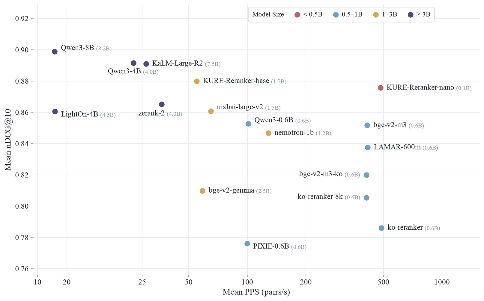

# Reranker Simple Benchmark
## Purpose
* 본 프로젝트는 Reranker Benchmark Evaluation을 최소한의 의존성으로 경량화하여, 누구나 쉽게 실행하고 즉각적인 결과를 얻을 수 있도록 설계되었습니다.

## Plan
* 본 프로젝트에서는 BM25 기반의 Stage 1 Retrieval을 통해 각 벤치마크 query 당 retrieval corpus를 1000개로 제한합니다. 각 query에 대한 정답 문서 정보를 포함하여, BM25 기준 상위 1000개 문서의 ID를 저장합니다.
* 이후 각 query 당 Top-k 50개의 corpus id를 활용하여, Stage 2 Reranking을 진행합니다.

## Stage 1 Retrieval
BM25 기반 Stage 1 검색(토크나이저별 비교, 실행 코드, 결과)은 [`eval/results/stage1/README.md`](eval/results/stage1/README.md)에 정리되어 있습니다. Stage 2 는 여기서 가장 높은 성능을 보인 **Mecab** tokenizer 의 BM25 결과를 1차 후보로 사용합니다.

## Stage 2 Reranking
### Benchmark Datasets
**공식 [MTEB(kor, v2)](https://github.com/embeddings-benchmark/mteb) 의 9개 Korean Retrieval 벤치마크** (총 12,054 queries)에 대한 평가를 진행하였습니다. 
각 task 는 MTEB 표준 `eval_splits` 를 그대로 사용합니다 (예: MLDR = dev+test 평균, MIRACL/Ko-StrategyQA = dev, 그 외 = test).

| 데이터셋 | 설명 | split | queries |
|---|---|---|---|
| [Ko-StrategyQA](https://huggingface.co/datasets/taeminlee/Ko-StrategyQA) | 한국어 ODQA multi-hop 검색 (StrategyQA 번역) | dev | 592 |
| [AutoRAGRetrieval](https://huggingface.co/datasets/yjoonjang/markers_bm) | 금융·공공·의료·법률·커머스 5개 분야 문서 검색 | test | 114 |
| [MIRACLRetrieval](https://huggingface.co/datasets/miracl/miracl) | Wikipedia 기반 한국어 문서 검색 | dev | 213 |
| [PublicHealthQA](https://huggingface.co/datasets/xhluca/publichealth-qa) | 의료·공중보건 도메인 문서 검색 | test | 77 |
| [BelebeleRetrieval](https://huggingface.co/datasets/facebook/belebele) | FLORES-200 기반 한국어 문서 검색 (kor_Hang-kor_Hang subset) | test | 900 |
| [MrTidyRetrieval](https://huggingface.co/datasets/mteb/mrtidy) | Wikipedia 기반 한국어 문서 검색 | test | 421 |
| [SQuADKorV1Retrieval](https://huggingface.co/datasets/yjoonjang/squad_kor_v1) | 한국어 SQuAD v1.0 기반 검색 | test | 5,774 |
| [LawIRKo](https://huggingface.co/datasets/on-and-on/lawgov_ir-ko) | 한국어 법률 정보 검색 | test | 3,563 |
| [MultiLongDocRetrieval](https://huggingface.co/datasets/Shitao/MLDR) | 다양한 도메인 한국어 장문 검색 | dev+test | 400 |
> **Note**: 기존 XPQARetrieval·WebFAQRetrieval 은 공식 MTEB(kor, v2) subset 이 아니므로 제외합니다.

### Evaluation Method
- **Gold-injected reranking**: 각 query 의 정답(gold) 문서를 재랭킹 후보 집합에 항상 포함시킨 뒤 (후보 = 정답 + BM25 상위 50개 중 정답을 뺀 나머지가 negative) reranker 로 재랭킹합니다.
- **Max sequence length**: 모든 모델을 `max_length=8192` 로 측정합니다. 단, 아키텍처상 8192 를 지원하지 않는 모델은 해당 모델의 최대 길이로 측정합니다.
- **Pairs Per Second (PPS)**: [Ettin-Reranker 블로그](https://huggingface.co/blog/ettin-reranker)를 참고하여, batch size 를 8 부터 2배씩 첫 OOM 까지 늘리며, 각 batch size 에서 샘플을 그 배수로 반복·길이 내림차순 정렬한 뒤 warmup 1회 + 3회 반복합니다. 모델 forward 호출만 CUDA event 로 재므로 토크나이즈·데이터 로딩은 제외되며, PPS = 처리 쌍 수 / forward 시간 합, 가장 빠른 batch size 의 값을 기록합니다.

### Evaluation Code
```bash
# NDCG + 추론 처리량(PPS)을 한 번에 — 한 번 로드한 모델을 bf16 + flash_attention_2 로 전환해 둘 다 측정.
uv run python eval/evaluate_reranker.py \
	--model_names BAAI/bge-reranker-v2-m3 \
	--gpu_id 0 \
	--batch_size 8 \
	--speed

# 또는 특정 데이터셋만 선택
uv run python eval/evaluate_reranker.py \
	--model_names "my_reranker_model" \
	--tasks Ko-StrategyQA AutoRAGRetrieval SQuADKorV1Retrieval LawIRKo \
	--gpu_id 0 \
	--batch_size 8 \
	--speed
```

### Leaderboard
```bash
cd eval
uv run streamlit run leaderboard_reranker.py
```

**추론 처리량 vs. 성능** 



### Results (Averaged)
<!-- **공식 9개 subset 을 모두 평가한 모델**의 9-subset mean NDCG@10, PPS -->
| Model | Params | Mean NDCG@10 | Mean PPS |
|---|---|---|---|
| [Qwen/Qwen3-Reranker-8B](https://huggingface.co/Qwen/Qwen3-Reranker-8B) | 8.2B | 0.8990 | 15.0 |
| [Qwen/Qwen3-Reranker-4B](https://huggingface.co/Qwen/Qwen3-Reranker-4B) | 4.0B | 0.8916 | 24.3 |
| [KaLM-Embedding/KaLM-Reranker-V1-Large-R2](https://huggingface.co/KaLM-Embedding/KaLM-Reranker-V1-Large-R2) | 7.5B | 0.8910 | 25.3 |
| [nlpai-lab/KURE-Reranker-base](https://huggingface.co/nlpai-lab/KURE-Reranker-base) | 1.7B | 0.8800 | 55.0 |
| [nlpai-lab/KURE-Reranker-nano](https://huggingface.co/nlpai-lab/KURE-Reranker-nano) | 149M | 0.8757 | 482.4 |
| [zeroentropy/zerank-2-reranker](https://huggingface.co/zeroentropy/zerank-2-reranker) | 4.0B | 0.8652 | 29.3 |
| [mixedbread-ai/mxbai-rerank-large-v2](https://huggingface.co/mixedbread-ai/mxbai-rerank-large-v2) | 1.5B | 0.8607 | 64.8 |
| [lightonai/LightOn-rerank-PW-4B](https://huggingface.co/lightonai/LightOn-rerank-PW-4B) | 4.5B | 0.8605 | 15.1 |
| [Qwen/Qwen3-Reranker-0.6B](https://huggingface.co/Qwen/Qwen3-Reranker-0.6B) | 596M | 0.8528 | 101.0 |
| [BAAI/bge-reranker-v2-m3](https://huggingface.co/BAAI/bge-reranker-v2-m3) | 568M | 0.8518 | 412.6 |
| [nvidia/llama-nemotron-rerank-1b-v2](https://huggingface.co/nvidia/llama-nemotron-rerank-1b-v2) | 1.2B | 0.8468 | 128.2 |
| [nlpai-lab/LAMAR-600m](https://huggingface.co/nlpai-lab/LAMAR-600m) | 568M | 0.8375 | 415.0 |
| [dragonkue/bge-reranker-v2-m3-ko](https://huggingface.co/dragonkue/bge-reranker-v2-m3-ko) | 568M | 0.8199 | 409.1 |
| [BAAI/bge-reranker-v2-gemma](https://huggingface.co/BAAI/bge-reranker-v2-gemma) | 2.5B | 0.8099 | 58.8 |
| [upskyy/ko-reranker-8k](https://huggingface.co/upskyy/ko-reranker-8k) | 568M | 0.8054 | 409.8 |
| [Dongjin-kr/ko-reranker](https://huggingface.co/Dongjin-kr/ko-reranker) | 560M | 0.7861 | 488.0 |
| [telepix/PIXIE-Spell-Reranker-Preview-0.6B](https://huggingface.co/telepix/PIXIE-Spell-Reranker-Preview-0.6B) | 596M | 0.7760 | 99.7 |

**Mean PPS** = 추론 처리량(query–document pairs/s), 9 subset 평균. RTX A6000 1장, bf16 + flash_attention_2 (`KaLM-Reranker-V1-Large-R2` 는 T5Gemma2 아키텍처로, flash_attention_2 를 지원하지 않아 sdpa를 사용).

> `jinaai/jina-reranker-v3` 와 `jinaai/jina-reranker-v3.5` 는 **listwise** reranker 로, 장문(`MultiLongDocRetrieval`)에서 다른 모델과 동일 조건(8192)으로 공정 비교가 불가능하여 두 모델 모두 MLDR 을 N/A 로 두고 위 9-subset 평가에서 제외합니다. 

### Per-dataset NDCG@10

| Model | Params | Ko-StrategyQA | AutoRAGRetrieval | PublicHealthQA | BelebeleRetrieval | MIRACLRetrieval | MrTidyRetrieval | MultiLongDocRetrieval | SQuADKorV1Retrieval | LawIRKo |
|---|---|---|---|---|---|---|---|---|---|---|
| Qwen/Qwen3-Reranker-8B | 8.2B | 0.8720 | 0.9653 | 0.8654 | 0.9785 | 0.8513 | 0.8416 | 0.8255 | 0.9897 | 0.9013 |
| Qwen/Qwen3-Reranker-4B | 4.0B | 0.8733 | 0.9630 | 0.8442 | 0.9794 | 0.8559 | 0.8298 | 0.8161 | 0.9861 | 0.8766 |
| KaLM-Embedding/KaLM-Reranker-V1-Large-R2 | 7.5B | 0.8796 | 0.9415 | 0.8633 | 0.9809 | 0.8382 | 0.8500 | 0.7970 | 0.9863 | 0.8824 |
| nlpai-lab/KURE-Reranker-base | 1.7B | 0.8548 | 0.9762 | 0.8381 | 0.9767 | 0.8371 | 0.7970 | 0.8163 | 0.9891 | 0.8343 |
| nlpai-lab/KURE-Reranker-nano | 149M | 0.8582 | 0.9741 | 0.8078 | 0.9768 | 0.8400 | 0.8011 | 0.7966 | 0.9895 | 0.8368 |
| jinaai/jina-reranker-v3.5 | 597M | 0.8539 | 0.9838 | 0.8337 | 0.9659 | 0.8565 | 0.8194 | — | 0.9887 | 0.8545 |
| jinaai/jina-reranker-v3 | 597M | 0.8553 | 0.9773 | 0.7762 | 0.9606 | 0.8449 | 0.8104 | — | 0.9859 | 0.8546 |
| zeroentropy/zerank-2-reranker | 4.0B | 0.8712 | 0.9436 | 0.8377 | 0.9731 | 0.8003 | 0.8027 | 0.7120 | 0.9791 | 0.8669 |
| mixedbread-ai/mxbai-rerank-large-v2 | 1.5B | 0.8563 | 0.9531 | 0.8407 | 0.9659 | 0.7939 | 0.8771 | 0.6787 | 0.9681 | 0.8130 |
| lightonai/LightOn-rerank-PW-4B | 4.5B | 0.8567 | 0.9321 | 0.8312 | 0.9735 | 0.8072 | 0.8091 | 0.7609 | 0.9803 | 0.7938 |
| Qwen/Qwen3-Reranker-0.6B | 596M | 0.8336 | 0.9321 | 0.8092 | 0.9721 | 0.8470 | 0.7325 | 0.7819 | 0.9804 | 0.7865 |
| BAAI/bge-reranker-v2-m3 | 568M | 0.8487 | 0.9663 | 0.7982 | 0.9725 | 0.8129 | 0.8222 | 0.6690 | 0.9853 | 0.7906 |
| nvidia/llama-nemotron-rerank-1b-v2 | 1.2B | 0.8536 | 0.9480 | 0.8130 | 0.9755 | 0.8182 | 0.8026 | 0.6719 | 0.9858 | 0.7527 |
| nlpai-lab/LAMAR-600m | 568M | 0.8461 | 0.9591 | 0.8044 | 0.9740 | 0.8214 | 0.7975 | 0.5679 | 0.9850 | 0.7822 |
| dragonkue/bge-reranker-v2-m3-ko | 568M | 0.8232 | 0.9684 | 0.8155 | 0.9744 | 0.7573 | 0.6776 | 0.7061 | 0.9846 | 0.6721 |
| BAAI/bge-reranker-v2-gemma | 2.5B | 0.8614 | 0.9407 | 0.8069 | 0.9696 | 0.8362 | 0.8429 | 0.2881 | 0.9858 | 0.7572 |
| upskyy/ko-reranker-8k | 568M | 0.8143 | 0.9230 | 0.7792 | 0.9609 | 0.7249 | 0.6998 | 0.5975 | 0.9718 | 0.7770 |
| Dongjin-kr/ko-reranker | 560M | 0.8468 | 0.9014 | 0.6976 | 0.9655 | 0.8017 | 0.7772 | 0.3721 | 0.9785 | 0.7343 |
| telepix/PIXIE-Spell-Reranker-Preview-0.6B | 596M | 0.8329 | 0.9794 | 0.8211 | 0.9689 | 0.8449 | 0.7650 | 0.1829 | 0.9850 | 0.6042 |

### Per-dataset PPS

| Model | Params | Ko-StrategyQA | AutoRAGRetrieval | PublicHealthQA | BelebeleRetrieval | MIRACLRetrieval | MrTidyRetrieval | MultiLongDocRetrieval | SQuADKorV1Retrieval | LawIRKo |
|---|---|---|---|---|---|---|---|---|---|---|
| Qwen/Qwen3-Reranker-8B | 8.2B | 16.5 | 7.4 | 15.3 | 20.5 | 25.0 | 26.6 | 0.7 | 10.8 | 12.4 |
| Qwen/Qwen3-Reranker-4B | 4.0B | 26.2 | 11.8 | 25.6 | 34.5 | 40.1 | 42.8 | 1.1 | 17.1 | 19.9 |
| KaLM-Embedding/KaLM-Reranker-V1-Large-R2 | 7.5B | 28.6 | 12.4 | 25.4 | 36.9 | 39.6 | 43.8 | 0.8 | 18.7 | 21.4 |
| nlpai-lab/KURE-Reranker-base | 1.7B | 59.2 | 27.3 | 58.0 | 77.0 | 89.1 | 97.1 | 2.6 | 39.1 | 45.7 |
| nlpai-lab/KURE-Reranker-nano | 149M | 475.4 | 233.2 | 529.0 | 750.0 | 765.8 | 855.2 | 16.5 | 330.8 | 386.0 |
| jinaai/jina-reranker-v3.5 | 597M | 141.0 | 38.6 | 123.2 | 197.5 | 277.3 | 295.7 | — | 68.4 | 86.7 |
| jinaai/jina-reranker-v3 | 597M | 113.8 | 25.0 | 95.7 | 166.3 | 244.6 | 261.6 | — | 48.7 | 64.0 |
| zeroentropy/zerank-2-reranker | 4.0B | 31.0 | 12.7 | 29.5 | 41.4 | 51.0 | 56.4 | 1.1 | 18.8 | 22.3 |
| mixedbread-ai/mxbai-rerank-large-v2 | 1.5B | 70.0 | 32.9 | 68.0 | 89.8 | 104.2 | 113.6 | 3.2 | 47.0 | 54.7 |
| lightonai/LightOn-rerank-PW-4B | 4.5B | 16.2 | 7.3 | 17.0 | 22.2 | 23.4 | 26.1 | 0.7 | 10.7 | 12.4 |
| Qwen/Qwen3-Reranker-0.6B | 596M | 105.9 | 49.4 | 109.5 | 145.8 | 162.6 | 177.4 | 4.3 | 70.8 | 83.6 |
| BAAI/bge-reranker-v2-m3 | 568M | 420.7 | 195.6 | 440.9 | 651.8 | 653.2 | 724.8 | 9.3 | 271.6 | 345.5 |
| nvidia/llama-nemotron-rerank-1b-v2 | 1.2B | 133.7 | 54.4 | 131.6 | 186.3 | 220.0 | 243.1 | 3.9 | 84.9 | 95.9 |
| nlpai-lab/LAMAR-600m | 568M | 418.0 | 196.5 | 442.5 | 651.1 | 656.7 | 742.5 | 9.2 | 275.0 | 343.8 |
| dragonkue/bge-reranker-v2-m3-ko | 568M | 416.9 | 195.1 | 434.4 | 641.3 | 653.4 | 716.7 | 9.2 | 271.9 | 342.7 |
| BAAI/bge-reranker-v2-gemma | 2.5B | 64.7 | 26.1 | 60.5 | 83.8 | 99.8 | 106.8 | 2.5 | 40.0 | 44.7 |
| upskyy/ko-reranker-8k | 568M | 411.8 | 195.6 | 436.2 | 641.7 | 649.3 | 726.0 | 9.2 | 275.1 | 342.8 |
| Dongjin-kr/ko-reranker | 560M | 520.8 | 258.0 | 468.3 | 644.1 | 747.6 | 765.2 | 272.7 | 334.4 | 381.2 |
| telepix/PIXIE-Spell-Reranker-Preview-0.6B | 596M | 104.6 | 49.4 | 106.3 | 141.5 | 160.5 | 175.6 | 4.3 | 72.1 | 82.6 |


## Citation

본 벤치마크를 연구에 활용하셨다면 아래와 같이 인용해 주세요.

```bibtex
@misc{reranker-simple-benchmark,
  title        = {Reranker Simple Benchmark},
  author       = {Sigrid Jin, Youngjoon Jang, Yongbin Choi, Daegon Yu, Kanghyeun Lee, Juna Jung, Junu Moon},
  year         = {2025},
  publisher    = {GitHub},
  journal      = {GitHub repository},
  howpublished = {\url{https://github.com/instructkr/reranker-simple-benchmark}}
}
```
